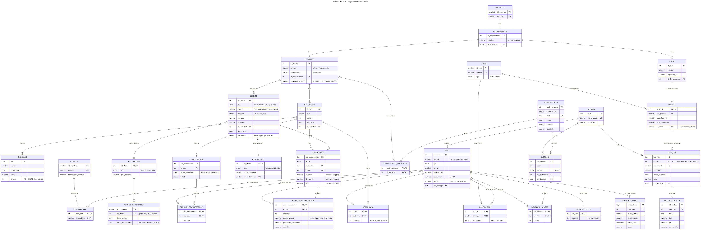

# 1. Modelo de datos

Este documento cubre la Etapa 1: entidades y claves, relaciones y cardinalidades, esquema relacional, normalización hasta 3FN y decisiones de diseño. El DER está en [`der/der.svg`](der/der.svg) (fuente editable: [`der/der.mmd`](der/der.mmd), Mermaid) y el diccionario de datos completo en [`diccionario_datos.md`](diccionario_datos.md).



## 1.1 Cómo se identificaron las entidades

Se leyó el escenario subrayando sustantivos con datos propios. Algo se modeló como **tabla propia** (y no como columna de otra) cuando cumplía al menos uno de estos criterios:

| Criterio | Ejemplos en el modelo |
| --- | --- |
| Tiene atributos propios que dependen de él | `departamento` (tiene provincia), `localidad` (tiene encargado y CP), `cepa` (tiene tipo) |
| Varias filas de otra tabla lo comparten | muchas fincas en un departamento, muchas salas en una localidad |
| Es multivaluado (1FN: nada de listas en una celda) | análisis de un lote, permisos de un exportador, maridajes y cepas de un vino |
| Tiene vida propia (existe aunque nadie lo referencie) | `cepa`, `maridaje`, `transportista` |
| Es una relación N:M con atributos | `composicion` (porcentaje), `renglon_comprobante` (cantidad, precio), `stock_sala` (cantidad) |

Y se dejó como **columna** lo que no cumplía ninguno: la campaña es un año dentro del lote (no tiene atributos), el día de cierre es un valor de un ENUM, el país de destino de un exportador es un texto.

## 1.2 Claves: naturales y subrogadas

Una **clave candidata** es un conjunto mínimo de atributos que identifica una fila. La **primaria** es la candidata elegida; las demás se declaran `UNIQUE`.

| Tabla | PK | Otras claves candidatas (UNIQUE) | Por qué |
| --- | --- | --- | --- |
| `bodega`, `empleado` | `cuit` (natural) | `bodega.razon_social` | El CUIT es único, estable y lo asigna ARCA. Si hubiera que corregirlo, `ON UPDATE CASCADE` lo propaga. |
| `transportista` | `cod_transporte` (subrogada) | `cuit` | El enunciado identifica al transportista por un código; el CUIT queda como candidata. |
| `localidad` | `id_localidad` (subrogada) | `(nombre, id_departamento)` | **El código postal no es clave**: en Mendoza, San Carlos y Eugenio Bustos comparten el 5569 (está en los datos). |
| `cliente` | `id_cliente` (subrogada) | `(tipo_doc, nro_doc)` | La natural sería compuesta (tipo y número) y la referencian comprobante y los subtipos: una FK de un solo entero es más simple y liviana. |
| `vino` | `cod_vino` (subrogada) | `(nombre, anada, volumen_ml)` | "Malbec Reserva 2021 750 ml" y "Malbec Reserva 2022 750 ml" son vinos distintos. |
| `parcela` | `(id_finca, nro_parcela)` | — | **Entidad débil**: "parcela 3" existe en muchas fincas; solo se identifica junto con su finca. |
| `lote_uva` | `nro_lote` | `(id_finca, nro_parcela, campania)` | Tiene **dos claves candidatas**: una es la PK y la otra es la regla RN-04. |
| `renglon_comprobante` | `(nro_comprobante, cod_vino)` | — | Un vino aparece una sola vez por comprobante. |
| `stock_sala` | `(id_sala, cod_vino)` | — | Una fila por sala y vino. |
| `permiso_exportacion` | `cod_permiso` | — | El permiso tiene su propio código. |

Las subrogadas se generan con `GENERATED ALWAYS AS IDENTITY` (estándar SQL, no se pueden escribir a mano por error).

## 1.3 Relaciones y cardinalidades

Regla aplicada: en una relación **1:N** la clave foránea va del lado N; en una **N:M** se crea una tabla intermedia y **los atributos de la relación viven en esa tabla**.

| Relación | Cardinalidad (mín, máx) | Implementación |
| --- | --- | --- |
| Provincia – Departamento – Localidad | 1:N, 1:N | FK en el lado N |
| Localidad – Sala | 1:N (una sala en exactamente una localidad) | `sala_venta.id_localidad NOT NULL` |
| Sala – Empleado | 1:N obligatoria del lado empleado | `empleado.id_sala NOT NULL` (RN-03) |
| Finca – Parcela | 1:N **identificadora** | `id_finca` es parte de la PK de parcela |
| Cepa – Parcela | 1:N (cada parcela tiene una sola cepa) | `parcela.id_cepa NOT NULL` (RN-04) |
| Parcela – Lote | 1:N, como máximo uno por campaña | FK compuesta + `UNIQUE (finca, parcela, campaña)` |
| Lote – Análisis | 1:N (uno o más) | FK en análisis |
| Bodega – Vino / Lote / Ingreso | 1:N | FK en cada una |
| **Vino – Cepa** | **N:M con atributo** | `composicion(cod_vino, id_cepa, porcentaje)` |
| Vino – Maridaje | N:M | `vino_maridaje` |
| Transportista – Localidad | N:M | `transportista_localidad` |
| **Comprobante – Vino** | **N:M con atributos** | `renglon_comprobante(cantidad, precio_unitario, porcentaje_descuento, subtotal)` |
| Ingreso – Vino, Transferencia – Vino | N:M con atributo cantidad | tablas de renglones |
| Sala – Vino (stock) | N:M con atributo cantidad | `stock_sala` |
| Vino – Depósito | 1:1 | `stock_deposito` con PK = FK `cod_vino` |
| Cliente – Distribuidor / Exportador | 1:0..1 (generalización) | PK del subtipo = FK al supertipo |
| Exportador – Permiso | 1:N | FK de `permiso_exportacion` **a `exportador`** |

## 1.4 Esquema relacional

Notación: **PK** en negrita, *FK* en cursiva (→ tabla referenciada).

```
PROVINCIA(id_provincia, nombre)                                            UK(nombre)
DEPARTAMENTO(id_departamento, nombre, id_provincia→PROVINCIA)              UK(nombre, id_provincia)
LOCALIDAD(id_localidad, nombre, codigo_postal, id_departamento→DEPARTAMENTO, encargado_regional)
SALA_VENTA(id_sala, calle, numero, dia_cierre, id_localidad→LOCALIDAD)
EMPLEADO(cuit, nombre, fecha_ingreso, salario, id_sala→SALA_VENTA)
FINCA(id_finca, nombre, superficie_ha, id_departamento→DEPARTAMENTO)
CEPA(id_cepa, nombre, tipo)                                                UK(nombre)
PARCELA(id_finca→FINCA, nro_parcela, superficie_ha, anio_plantacion, id_cepa→CEPA)
BODEGA(cuit, razon_social, domicilio)                                      UK(razon_social)
LOTE_UVA(nro_lote, (id_finca, nro_parcela)→PARCELA, campania, fecha_cosecha, kilos, cuit_bodega→BODEGA)
                                                                           UK(id_finca, nro_parcela, campania)
ANALISIS_CALIDAD(id_analisis, nro_lote→LOTE_UVA, fecha, brix, ph, acidez_total)
VINO(cod_vino, nombre, tipo, anada, volumen_ml, graduacion, precio, cuit_bodega→BODEGA)
                                                                           UK(nombre, anada, volumen_ml)
COMPOSICION(cod_vino→VINO, id_cepa→CEPA, porcentaje)
MARIDAJE(id_maridaje, nombre, temperatura_servicio)                        UK(nombre)
VINO_MARIDAJE(cod_vino→VINO, id_maridaje→MARIDAJE)
CLIENTE(id_cliente, tipo, nombre, tipo_doc, nro_doc, direccion, id_localidad→LOCALIDAD, fecha_alta, descuento)
                                                                           UK(tipo_doc, nro_doc), UK(id_cliente, tipo)
DISTRIBUIDOR(id_cliente, tipo, zona_cobertura, nro_habilitacion)           FK (id_cliente, tipo)→CLIENTE, UK(nro_habilitacion)
EXPORTADOR(id_cliente, tipo, pais_destino)                                 FK (id_cliente, tipo)→CLIENTE
PERMISO_EXPORTACION(cod_permiso, id_cliente→EXPORTADOR, fecha_emision, fecha_vencimiento)
COMPROBANTE(nro_comprobante, fecha, id_cliente→CLIENTE, id_sala→SALA_VENTA, subtotal, descuento, total)
RENGLON_COMPROBANTE(nro_comprobante→COMPROBANTE, cod_vino→VINO, cantidad, precio_unitario, porcentaje_descuento, subtotal)
TRANSPORTISTA(cod_transporte, razon_social, cuit, email, telefono, domicilio)   UK(cuit)
TRANSPORTISTA_LOCALIDAD(cod_transporte→TRANSPORTISTA, id_localidad→LOCALIDAD)
INGRESO(cod_ingreso, fecha, estado, cod_transporte→TRANSPORTISTA, cuit_bodega→BODEGA)
RENGLON_INGRESO(cod_ingreso→INGRESO, cod_vino→VINO, cantidad)
TRANSFERENCIA(nro_transferencia, id_sala→SALA_VENTA, fecha_confeccion, estado)
RENGLON_TRANSFERENCIA(nro_transferencia→TRANSFERENCIA, cod_vino→VINO, cantidad)
STOCK_SALA(id_sala→SALA_VENTA, cod_vino→VINO, cantidad)
STOCK_DEPOSITO(cod_vino→VINO, cantidad)
AUDITORIA_PRECIO(id_auditoria, cod_vino→VINO, precio_anterior, precio_nuevo, fecha_hora, usuario)
```

PK por tabla: el primer atributo, salvo en `PARCELA (id_finca, nro_parcela)`, `COMPOSICION (cod_vino, id_cepa)`, `VINO_MARIDAJE`, `TRANSPORTISTA_LOCALIDAD`, `RENGLON_*`, `STOCK_SALA (id_sala, cod_vino)`, que tienen PK compuesta.

## 1.5 Dependencias funcionales y normalización

Una **dependencia funcional** X → Y significa: si dos filas tienen el mismo X, tienen el mismo Y. Las formas normales se verifican con ellas:

- **1FN**: todos los atributos son atómicos (sin listas ni grupos repetidos).
- **2FN**: 1FN y ningún atributo no clave depende de **una parte** de una clave compuesta (sin dependencias parciales).
- **3FN**: 2FN y ningún atributo no clave depende de **otro atributo no clave** (sin dependencias transitivas). Formalmente: para toda X → A no trivial, X es superclave o A es parte de una clave candidata.

### Dependencias relevantes detectadas

| Dependencia | Dónde quedó | Qué se evitó |
| --- | --- | --- |
| `localidad → encargado_regional` | columna de `localidad` | Si estuviera en `sala_venta`: sala → localidad → encargado (**transitiva**). Dos salas de la misma localidad podrían tener encargados distintos (contradice RN-02) y habría que actualizar N salas para cambiar un encargado. |
| `departamento → provincia` | `departamento.id_provincia` | Si finca guardara depto y provincia: finca → depto → provincia (**transitiva**), con la provincia repetida en cada finca. |
| `localidad → departamento → provincia` | cadena de FK | Idem para clientes y salas. |
| `cepa → tipo` | `cepa.tipo` | Si parcela guardara el tipo de cepa: parcela → cepa → tipo (transitiva). |
| `vino → precio, bodega, graduación, …` | `vino` | El precio no se repite por sala (RN-01). |
| `(nro_comprobante, cod_vino) → cantidad, precio_unitario, …` | `renglon_comprobante` | Depende de la clave **completa**. |
| `nro_comprobante → fecha, cliente, sala` | `comprobante` | Si el renglón guardara la fecha del comprobante: dependería de **parte** de su clave (**parcial**, viola 2FN). Por eso cabecera y renglones son tablas distintas. |
| `cod_vino → nombre del vino` | `vino` | El renglón no repite el nombre del vino (sería parcial). |
| `(id_finca, nro_parcela) → superficie, cepa` | `parcela` | |
| `(id_finca, nro_parcela, campania) → nro_lote, kilos, fecha` | `lote_uva` | Es clave candidata: no viola 3FN. |
| `id_cliente → tipo` y `tipo → descuento base` | ver 1.6 | El descuento base es una función del tipo (`fn_descuento_por_tipo`); el descuento vigente es un dato del cliente. |

### Verificación tabla por tabla

- **1FN**: los atributos multivaluados del enunciado (cepas de un vino, maridajes, análisis de un lote, permisos de un exportador, localidades de un transportista, vinos de un comprobante/ingreso/transferencia) están en tablas propias.
- **2FN**: las únicas tablas con PK compuesta son las intermedias y `parcela`. En todas, los atributos no clave dependen de la clave completa: la cantidad de un renglón depende del comprobante **y** del vino; el porcentaje de corte depende del vino **y** de la cepa; la superficie de una parcela depende de la finca **y** del número.
- **3FN**: no quedan dependencias entre atributos no clave (ver tabla anterior). Las dependencias cuyo lado izquierdo no es la PK tienen como lado izquierdo una **clave candidata** declarada `UNIQUE` (por ejemplo `(nombre, anada, volumen_ml) → cod_vino`), así que no violan 3FN.

### Redundancias que se decidieron conservar (y cómo se controlan)

| Dato almacenado | Por qué se guarda | Cómo se garantiza su consistencia |
| --- | --- | --- |
| `renglon_comprobante.precio_unitario` | **No es redundante**: es el precio al momento de la venta. Depende de (comprobante, vino), no solo del vino. Sin él, subir un precio cambiaría todas las facturas viejas. | Lo completa el trigger con `vino.precio` en el INSERT; luego no se modifica. |
| `renglon_comprobante.subtotal` | Evita recalcular 500.000 renglones en cada reporte. | Trigger BEFORE con `fn_subtotal_renglon`; consulta de control. |
| `comprobante.subtotal, descuento, total` | Derivados de los renglones. Se guardan porque los reportes de ventas leen 150.000 comprobantes y el total no debe cambiar si cambia un precio. | Trigger AFTER sobre renglones (RN-08); un trigger sobre comprobante rechaza cargarlos a mano; `CHECK (total = subtotal - descuento)`; la API no tiene permiso UPDATE. |
| `stock_sala`, `stock_deposito` | El stock es derivable del historial (ingresado − transferido − vendido), pero calcularlo en cada venta sería lento y **el historial se depura** (consultas D1 y D5). | Solo lo mueven triggers y procedimientos; `CHECK (cantidad >= 0)`; consultas de control después de la carga. |
| `cliente.descuento` | Ver 1.6. | Se inicializa por trigger según el tipo; `CHECK` de rango. |
| `distribuidor.tipo`, `exportador.tipo` | Columna constante que habilita la FK compuesta. | `CHECK (tipo = 'distribuidor')` + `DEFAULT`. |

## 1.6 Decisiones de diseño y alternativas descartadas

### Jerarquía de clientes: supertipo + subtipos

| Alternativa | Ventajas | Desventajas | Decisión |
| --- | --- | --- | --- |
| Tabla única con columna `tipo` y todas las columnas | Simple, sin joins | Muchos NULL (zona y habilitación vacías en socios y exportadores); un permiso podría apuntar a un socio y evitarlo exigiría un trigger | Descartada |
| Una tabla por subtipo, sin supertipo | Sin NULL | `comprobante` tendría que apuntar a tres tablas (tres FK opcionales o ninguna FK) | Descartada |
| **Supertipo + subtipos** | Sin NULL; `comprobante` tiene una sola FK; `permiso_exportacion` referencia a `exportador` | Un JOIN para ver los datos completos | **Elegida** |

Detalles:

- **Socio no tiene tabla**: no tiene atributos propios, así que una tabla `socio(id_cliente)` no agregaría información.
- **Coherencia entre `cliente.tipo` y el subtipo**: la FK es compuesta `(id_cliente, tipo) → cliente(id_cliente, tipo)` y el subtipo tiene `CHECK (tipo = 'distribuidor')`. Así es imposible cargar un distribuidor que apunte a un cliente socio (lo verifica `db_tests.sql`).
- **Limitación conocida**: el modelo no obliga a que un cliente de tipo distribuidor *tenga* su fila en `distribuidor` (participación total). Se podría con un constraint trigger diferido; se resolvió en la API, que crea supertipo y subtipo en la misma transacción.

### El descuento se almacena

RN-06 dice que el descuento depende del tipo, lo que sugiere calcularlo. Pero la consulta U6 pide "subirles el descuento al 35 %" a ciertos exportadores: si el descuento fuera solo función del tipo, U6 no tendría sentido. Por eso:

- `fn_descuento_por_tipo(tipo)` (IMMUTABLE) da el valor base: 10, 20 o 30.
- `cliente.descuento` guarda el descuento vigente; un trigger BEFORE INSERT lo inicializa con el valor base si no se envía.
- `CHECK (descuento BETWEEN 0 AND 50)` lo acota.
- El renglón guarda el porcentaje aplicado en esa venta, así un cambio posterior no altera ventas pasadas.

### Stock del depósito en tabla aparte (y no columna de vino)

1. El stock cambia con cada movimiento y el precio casi nunca: separarlos evita bloquear y reescribir la fila del vino en cada venta o transferencia.
2. La auditoría de precio es un trigger `AFTER UPDATE OF precio` sobre `vino`; si el stock estuviera en `vino`, cada movimiento haría un UPDATE sobre esa tabla.
3. Si mañana hubiera un segundo depósito, `stock_deposito` se extiende con una columna `id_deposito` sin tocar `vino`.

### Encargado regional como texto en `localidad`

Se evaluó modelarlo como FK a `empleado`. Se descartó porque el enunciado lo define como responsable de **todas** las salas de la localidad (no trabaja en una sala, y RN-03 exige que todo empleado tenga sala) y porque crearía un ciclo de FK (empleado → sala → localidad → empleado) que complica la carga. Es un dato que depende solo de la localidad.

### Tipos de datos

- Dinero: dominio `dinero = NUMERIC(12,2)`. **Nunca FLOAT**: el punto flotante no representa exactamente 0,10 y los totales tendrían errores de redondeo.
- Fechas: `DATE`; la auditoría usa `TIMESTAMPTZ` (momento exacto, con zona horaria).
- Estados, tipos de vino, de cepa, de cliente, de documento y días: `ENUM` (un estado mal escrito es un error, no texto libre).
- CUIT: dominio `cuit_dom = CHAR(11)` con `CHECK` de 11 dígitos.

### Acciones referenciales

| Acción | Dónde | Por qué |
| --- | --- | --- |
| `ON DELETE RESTRICT` | movimientos y catálogos referenciados: vino, bodega, transportista, cliente, sala, cepa, maridaje | RN-14: no se borra algo con historia. Un error es mejor que perder datos. |
| `ON DELETE CASCADE` | renglones (de comprobante, ingreso, transferencia), parcelas desde finca, composición y maridajes desde vino, subtipos desde cliente, permisos desde exportador, stock desde vino | Son filas que **no existen sin su cabecera** (entidades débiles o partes de un todo). |
| `ON UPDATE CASCADE` | FK a CUIT (bodega) | Es la única PK natural que se podría corregir. Las IDENTITY no se actualizan. |

### Lo que se calcula y no se guarda

- Antigüedad de empleados y clientes: `fn_antiguedad_anios(fecha)` (depende de hoy; guardarla la dejaría vieja al día siguiente).
- Stock total de un vino: `fn_stock_total` / vista `v_stock_total_vino`.
- Provincia de una localidad o finca: se obtiene por JOIN.
- Rendimiento kg/ha: se calcula en la consulta S10.

## 1.7 Errores o límites conocidos del modelo

Se dejan escritos porque se espera poder defenderlos:

- La participación total en la jerarquía de clientes la garantiza la API, no la base (ver 1.6).
- Un ingreso puede incluir vinos de una bodega distinta de la bodega de origen del ingreso: el enunciado no lo prohíbe explícitamente. Se podría agregar con un trigger.
- `parcela.superficie_ha` no se controla contra la superficie total de la finca (sería una regla entre filas y tablas: trigger).
- Las ventas históricas cargadas usan el precio actual de cada vino (no se generó historial de precios para la carga masiva).
