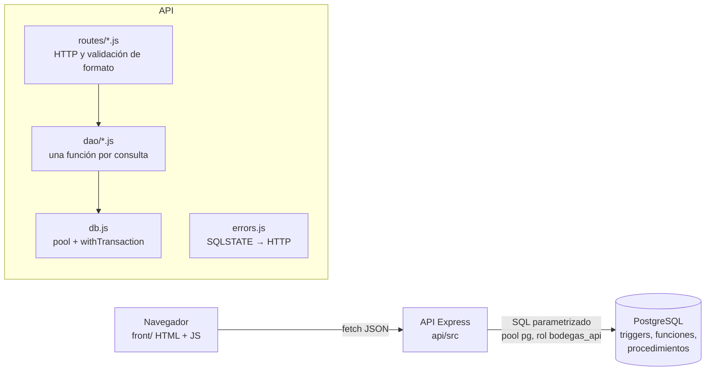
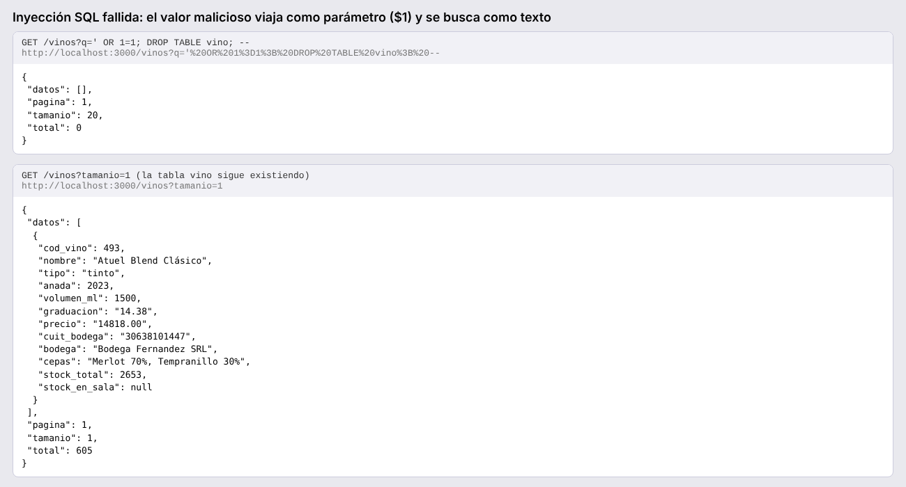

# 6 y 7. API REST y front

## 6.1 Arquitectura



- **Node 22 + Express + `pg`** (driver nativo). Sin ORM ni query builder: todo el SQL está escrito a mano en `api/src/dao/`.
- **Capa de acceso a datos propia**: una función por consulta (`dao/vinos.js`, `clientes.js`, `comprobantes.js`, `documentos.js`, `reportes.js`). Las rutas no tienen SQL.
- **Consultas parametrizadas** (`$1`, `$2`): el texto del usuario viaja separado del SQL y nunca se concatena. En los filtros dinámicos del catálogo solo se decide *qué* condiciones van; su contenido siempre es un parámetro.
- **Pool de conexiones** (`db.js`) configurado por variables de entorno (`DATABASE_URL`, `DB_SSL`).
- **Transacciones explícitas** (`withTransaction`: `BEGIN` / `COMMIT` / `ROLLBACK`) en las operaciones de varias sentencias: alta de vino con composición, alta de cliente con subtipo, venta completa, alta de documentos con renglones.
- **Rol `bodegas_api`**, nunca el propietario: `/salud` muestra con qué rol está conectada.
- **La API no recalcula**: no calcula totales, descuentos ni stock. La venta envía solo cliente, sala, vinos y cantidades; procesar llama al procedimiento con `CALL`.

## 6.2 Endpoints

Documentación interactiva (Swagger UI): `http://localhost:3000/docs`. Especificación: `api/openapi.yaml`.

| Recurso | Rutas |
| --- | --- |
| Salud | `GET /salud` |
| Catálogos | `GET /catalogos` |
| Vinos | `GET /vinos?tipo&cepa&bodega&anada&q&sala&pagina&tamanio`, `GET /vinos/{cod}`, `GET /vinos/{cod}/precios`, `POST /vinos`, `PUT /vinos/{cod}`, `DELETE /vinos/{cod}` |
| Clientes | `GET /clientes`, `GET /clientes/{id}`, `POST`, `PUT`, `DELETE` (los tres tipos) |
| Comprobantes | `POST /comprobantes`, `GET /comprobantes/{nro}`, `GET /comprobantes` |
| Transferencias | `GET /transferencias`, `GET /transferencias/{nro}`, `POST /transferencias`, `POST /transferencias/{nro}/renglones`, `DELETE /transferencias/{nro}/renglones/{cod}`, `POST /transferencias/{nro}/terminar`, `POST /transferencias/{nro}/procesar` |
| Ingresos | el mismo circuito bajo `/ingresos` |
| Reportes | `GET /reportes/top-vinos`, `/ventas-por-sala`, `/vinos-sin-stock?sala=`, `/transportista-activo`, `/trazabilidad/{cod}`, `/ventas-mensuales`, `/documentos-pendientes` |

## 6.3 Traducción de errores

`api/src/errors.js`. El mensaje que devuelve la API es el de la base (por ejemplo `RN-09: stock insuficiente del vino 26 en la sala 1 (disponible 0, pedido 2)`), junto con el SQLSTATE, la restricción y la regla.

| Situación | SQLSTATE | HTTP |
| --- | --- | --- |
| UNIQUE violado | 23505 | 409 Conflict |
| FK: el dato relacionado no existe | 23503 | 422 Unprocessable Entity |
| FK: se intenta borrar algo con dependientes (RN-14) | 23503 | 409 Conflict |
| CHECK / NOT NULL | 23514 / 23502 | 422 |
| Regla de negocio (RAISE EXCEPTION en trigger o procedimiento) | P0001 | 409, con la regla (`RN-xx`) |
| Documento inexistente al procesar | P0002 | 404 |
| Formato inválido (enum, número, fecha) | 22P02 / 22007 | 400 |
| Serialización o deadlock | 40001 / 40P01 | 503 con `Retry-After` |
| Permiso denegado | 42501 | 403 |

Ejemplo de respuesta:

```json
{
  "error": {
    "mensaje": "RN-09: stock insuficiente del vino 26 en la sala 1 (disponible 0, pedido 2)",
    "sqlstate": "P0001",
    "regla": "RN-09"
  }
}
```

## 6.4 Pruebas automáticas

`api/tests/api.test.js` (`node:test`, 22 pruebas, `npm test`). Crean sus propios datos (vino, ingreso, transferencia, venta) por el circuito real. **11 provocan a propósito una violación de una regla de la base** (y una verifica el 404) y comprueban el código HTTP y que no queden datos a medias:

| Prueba | Regla | HTTP |
| --- | --- | --- |
| composición que suma 90 (y el vino no queda) | RN-05 | 409 |
| precio negativo | RN-01 | 422 |
| vino duplicado | UNIQUE | 409 |
| vender más que el stock, con un renglón válido antes (todo o nada) | RN-09 | 409 |
| borrar un vino con ventas | RN-14 | 409 |
| procesar transferencia sin stock (queda terminada) | RN-11 | 409 |
| procesar ingreso en confección | RN-10 | 409 |
| agregar renglón a transferencia procesada | RN-12 | 409 |
| permiso con fechas invertidas (y el cliente no queda) | RN-07 | 422 |
| descuento fuera de rango | RN-06 | 422 |
| tipo de vino inexistente | ENUM | 400 |
| transferencia inexistente | — | 404 |

Las demás verifican: rol `bodegas_api`, paginación y filtros, alta y ficha de un vino, auditoría de precio (con el usuario), venta correcta (precio, 10 % de descuento de socio, total = suma de renglones, stock descontado), alta de exportador con 30 % y reportes.

## 6.5 Inyección SQL fallida

Prueba `inyección SQL fallida` y a mano:

```bash
curl "http://localhost:3000/vinos?q=%27%20OR%201%3D1%3B%20DROP%20TABLE%20vino%3B%20--"
# {"datos":[],"pagina":1,"tamanio":20,"total":0}
```

El valor `' OR 1=1; DROP TABLE vino; --` llega a la base como **el parámetro `$1`** de `v.nombre ILIKE '%' || $1 || '%'`: se busca un vino cuyo nombre contenga ese texto literal. No hay ninguno, la respuesta es una lista vacía y la tabla sigue existiendo. 

Si el SQL se armara concatenando (`"... ILIKE '%" + q + "%'"`), la comilla cerraría el texto y el resto se ejecutaría como SQL.

## 7.1 Front

`front/`: HTML + CSS + JavaScript sin frameworks, servido por nginx en Docker. `js/api.js` es la única capa que habla con la API (URL base configurable en `js/config.js`, que en Docker se genera desde `API_URL`).

| Pantalla | Qué permite |
| --- | --- |
| Catálogo | listado paginado con filtros por nombre, tipo, cepa, bodega y añada; ficha con composición, maridajes y stock |
| Alta y edición de vino | formulario con cepas y porcentajes y maridajes; muestra el error RN-05 de la base; historial de precios auditados |
| Nueva venta | sala, cliente (búsqueda), vinos con stock en la sala y cantidades; muestra el comprobante con precio, descuento y total **calculados por la base**; muestra el error RN-09 |
| Transferencias | listado con filtros, alta, renglones, botones Terminar y Procesar habilitados según el estado; muestra los errores RN-11 y RN-12 |
| Tablero | top 10 de vinos (S1), ventas por sala del último trimestre (S8, gráfico de barras), vinos sin stock en una sala con stock en el depósito (S6) |

**El front no calcula importes ni stock**: no multiplica precios ni suma subtotales. Los botones deshabilitados son solo ayuda visual; si se llamara a la API igual, la base rechazaría la operación. Las capturas de las pantallas están en `docs/capturas/`.
