| | |
| --- | --- |
| **Grupo** | 15 |
| **Integrante** | Carla Cialona (trabajo individual) |
| **Legajo** | 8852 |
| **Repositorio** | https://github.com/carlacialona/Trabajo-Pr-ctico-Integrador-Base-de-Datos---Grupo-15 |
| **Versión en la nube** | Front: https://bodegas-front-pxxx.onrender.com · API: https://bodegas-api-7s4s.onrender.com (documentación en /docs) |

# 1. Introducción y alcance

El trabajo implementa el sistema de gestión y distribución de Bodegas del Atuel, una empresa vitivinícola ficticia del sur de Mendoza. Cubre la producción de uva (fincas, parcelas, cosechas y análisis de calidad), la elaboración (bodegas, vinos, cortes y maridajes), la distribución (depósito central, ingresos y transferencias a las salas) y la venta (clientes de tres tipos y comprobantes con descuento).

El foco está en la **capa de datos**. El modelo está normalizado hasta tercera forma normal y las quince reglas de negocio se garantizan **dentro de PostgreSQL** con restricciones, funciones, procedimientos y triggers. Así se cumplen aunque alguien use la base sin pasar por la API (desde `psql`, DBeaver o un script). La API y el front son el medio para mostrar que la base funciona como parte de un sistema: no calculan totales, descuentos ni stock.

| Componente | Tecnología |
| --- | --- |
| Base de datos | PostgreSQL 16 |
| Carga masiva | Python 3 + psycopg 3 + Faker (semilla fija), carga con `COPY` |
| API | Node.js 22 + Express + `pg` (driver nativo, SQL escrito a mano, sin ORM); documentación OpenAPI |
| Front | HTML, CSS y JavaScript sin frameworks, servido por nginx |
| Contenedores | Docker Compose: base, carga, API y front con un solo comando |
| Modelado | Mermaid (fuente `docs/der/der.mmd`, exportado a SVG y PNG) |
| Asistencia | Se usó un asistente de IA (Claude) como apoyo durante el desarrollo; las decisiones de diseño fueron revisadas y se justifican en este informe. |

**Cómo reproducirlo**: copiar `.env.example` a `.env`, completar las contraseñas y ejecutar `docker compose up --build`. El front queda en http://localhost:8080 y la API (con su documentación en `/docs`) en http://localhost:3000.

# 2. Modelo de datos

## 2.1 Diagrama entidad-relación

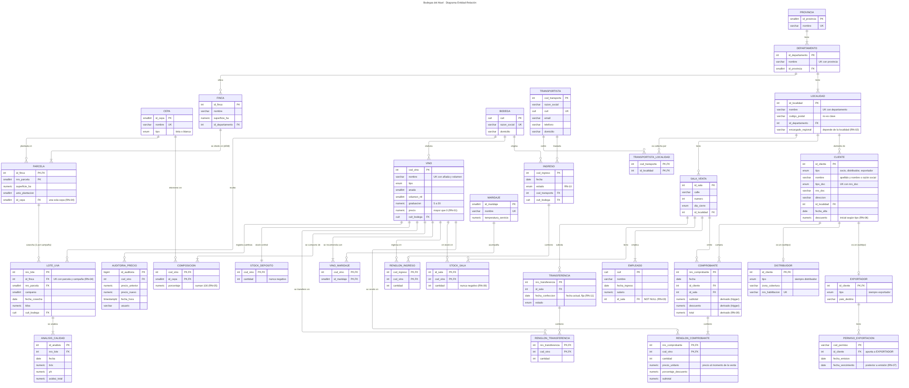

## 2.2 Cómo se identificaron las entidades

Algo se modeló como **tabla propia** (y no como columna de otra) cuando cumplía al menos uno de estos criterios:

| Criterio | Ejemplos |
| --- | --- |
| Tiene atributos propios que dependen de él | departamento (tiene provincia), localidad (encargado y código postal), cepa (tipo) |
| Varias filas de otra tabla lo comparten | muchas fincas en un departamento, muchas salas en una localidad |
| Es multivaluado (1FN: sin listas dentro de una celda) | análisis de un lote, permisos de un exportador, cepas y maridajes de un vino |
| Tiene vida propia | cepa, maridaje, transportista |
| Es una relación N:M con atributos | composición (porcentaje), renglón de comprobante (cantidad, precio), stock de sala (cantidad) |

Quedó como **columna** lo que no cumplía ninguno: la campaña es un año dentro del lote, el día de cierre es un valor de un tipo enumerado y el país de destino de un exportador es un texto.

## 2.3 Claves

| Tabla | Clave primaria | Otras claves candidatas (UNIQUE) | Justificación |
| --- | --- | --- | --- |
| bodega, empleado | `cuit` (natural) | `bodega.razon_social` | El CUIT es único y estable; `ON UPDATE CASCADE` permite corregirlo. |
| transportista | `cod_transporte` | `cuit` | El enunciado lo identifica por código; el CUIT queda como candidata. |
| localidad | `id_localidad` (subrogada) | (nombre, departamento) | El código postal no es clave: San Carlos y Eugenio Bustos comparten el 5569. |
| cliente | `id_cliente` (subrogada) | (tipo_doc, nro_doc) | La natural es compuesta y la referencian comprobante y los subtipos. |
| vino | `cod_vino` (subrogada) | (nombre, añada, volumen) | "Malbec Reserva 2021 750 ml" y "Malbec Reserva 2022 750 ml" son vinos distintos. |
| parcela | (id_finca, nro_parcela) | — | Entidad débil: "parcela 3" existe en muchas fincas. |
| lote_uva | `nro_lote` | (finca, parcela, campaña) | Dos claves candidatas: una es la PK y la otra es la regla RN-04. |
| renglon_comprobante | (nro_comprobante, cod_vino) | — | Un vino aparece una sola vez por comprobante. |

## 2.4 Relaciones y cardinalidades

En una relación **1:N** la clave foránea va del lado N. En una **N:M** se crea una tabla intermedia y **los atributos de la relación viven en esa tabla**.

| Relación | Cardinalidad | Implementación |
| --- | --- | --- |
| Localidad – Sala | 1:N | `sala_venta.id_localidad NOT NULL` |
| Sala – Empleado | 1:N, obligatoria para el empleado | `empleado.id_sala NOT NULL` (RN-03) |
| Finca – Parcela | 1:N identificadora | `id_finca` es parte de la PK de parcela |
| Cepa – Parcela | 1:N | `parcela.id_cepa NOT NULL` (una sola cepa, RN-04) |
| Parcela – Lote | 1:N, una por campaña | FK compuesta + UNIQUE con la campaña |
| Vino – Cepa | N:M con porcentaje | `composicion` |
| Vino – Maridaje | N:M | `vino_maridaje` |
| Transportista – Localidad | N:M | `transportista_localidad` |
| Comprobante – Vino | N:M con cantidad, precio, descuento y subtotal | `renglon_comprobante` |
| Ingreso / Transferencia – Vino | N:M con cantidad | tablas de renglones |
| Sala – Vino (stock) | N:M con cantidad | `stock_sala` |
| Vino – Depósito | 1:1 | `stock_deposito` (PK = FK `cod_vino`) |
| Cliente – Distribuidor / Exportador | 1:0..1 (generalización) | PK del subtipo = FK al supertipo |
| Exportador – Permiso | 1:N | FK de `permiso_exportacion` a `exportador` |

## 2.5 Esquema relacional

Notación: el primer atributo es la clave primaria (salvo las claves compuestas indicadas); `→` indica clave foránea.

```
PROVINCIA(id_provincia, nombre)
DEPARTAMENTO(id_departamento, nombre, id_provincia→PROVINCIA)
LOCALIDAD(id_localidad, nombre, codigo_postal, id_departamento→DEPARTAMENTO, encargado_regional)
SALA_VENTA(id_sala, calle, numero, dia_cierre, id_localidad→LOCALIDAD)
EMPLEADO(cuit, nombre, fecha_ingreso, salario, id_sala→SALA_VENTA)
FINCA(id_finca, nombre, superficie_ha, id_departamento→DEPARTAMENTO)
CEPA(id_cepa, nombre, tipo)
PARCELA((id_finca→FINCA, nro_parcela), superficie_ha, anio_plantacion, id_cepa→CEPA)
BODEGA(cuit, razon_social, domicilio)
LOTE_UVA(nro_lote, (id_finca, nro_parcela)→PARCELA, campania, fecha_cosecha, kilos, cuit_bodega→BODEGA)
ANALISIS_CALIDAD(id_analisis, nro_lote→LOTE_UVA, fecha, brix, ph, acidez_total)
VINO(cod_vino, nombre, tipo, anada, volumen_ml, graduacion, precio, cuit_bodega→BODEGA)
COMPOSICION((cod_vino→VINO, id_cepa→CEPA), porcentaje)
MARIDAJE(id_maridaje, nombre, temperatura_servicio)
VINO_MARIDAJE((cod_vino→VINO, id_maridaje→MARIDAJE))
CLIENTE(id_cliente, tipo, nombre, tipo_doc, nro_doc, direccion, id_localidad→LOCALIDAD, fecha_alta, descuento)
DISTRIBUIDOR(id_cliente, tipo, zona_cobertura, nro_habilitacion)   FK (id_cliente, tipo)→CLIENTE
EXPORTADOR(id_cliente, tipo, pais_destino)                         FK (id_cliente, tipo)→CLIENTE
PERMISO_EXPORTACION(cod_permiso, id_cliente→EXPORTADOR, fecha_emision, fecha_vencimiento)
COMPROBANTE(nro_comprobante, fecha, id_cliente→CLIENTE, id_sala→SALA_VENTA, subtotal, descuento, total)
RENGLON_COMPROBANTE((nro_comprobante→COMPROBANTE, cod_vino→VINO), cantidad, precio_unitario,
                    porcentaje_descuento, subtotal)
TRANSPORTISTA(cod_transporte, razon_social, cuit, email, telefono, domicilio)
TRANSPORTISTA_LOCALIDAD((cod_transporte→TRANSPORTISTA, id_localidad→LOCALIDAD))
INGRESO(cod_ingreso, fecha, estado, cod_transporte→TRANSPORTISTA, cuit_bodega→BODEGA)
RENGLON_INGRESO((cod_ingreso→INGRESO, cod_vino→VINO), cantidad)
TRANSFERENCIA(nro_transferencia, id_sala→SALA_VENTA, fecha_confeccion, estado)
RENGLON_TRANSFERENCIA((nro_transferencia→TRANSFERENCIA, cod_vino→VINO), cantidad)
STOCK_SALA((id_sala→SALA_VENTA, cod_vino→VINO), cantidad)
STOCK_DEPOSITO(cod_vino→VINO, cantidad)
AUDITORIA_PRECIO(id_auditoria, cod_vino→VINO, precio_anterior, precio_nuevo, fecha_hora, usuario)
```

## 2.6 Dependencias funcionales y normalización

- **1FN**: los atributos multivaluados del enunciado (cepas y maridajes de un vino, análisis de un lote, permisos de un exportador, localidades de un transportista, vinos de cada documento) están en tablas propias.
- **2FN**: en las tablas con clave compuesta, los atributos dependen de la clave completa. La cantidad de un renglón depende del comprobante **y** del vino; el porcentaje de corte, del vino **y** de la cepa. La fecha y el cliente están en la cabecera del comprobante: si estuvieran en el renglón dependerían solo de `nro_comprobante`, que es parte de su clave (dependencia parcial).
- **3FN**: no quedan dependencias entre atributos no clave. Las dependencias cuyo lado izquierdo no es la clave primaria tienen como lado izquierdo una clave candidata declarada UNIQUE.

| Dependencia detectada | Dónde quedó | Qué se evitó |
| --- | --- | --- |
| localidad → encargado_regional | columna de `localidad` | En `sala_venta` sería transitiva (sala → localidad → encargado): dos salas de la misma localidad podrían tener encargados distintos (contradice RN-02). |
| departamento → provincia | `departamento.id_provincia` | En `finca` sería transitiva (finca → departamento → provincia). |
| cepa → tipo | `cepa.tipo` | En `parcela` sería transitiva. |
| vino → precio | `vino.precio` | El precio no se repite por sala (RN-01). |
| (comprobante, vino) → precio_unitario | `renglon_comprobante` | Ver redundancias conservadas. |

### Redundancias conservadas y cómo se controlan

| Dato | Por qué se guarda | Cómo se garantiza su consistencia |
| --- | --- | --- |
| `renglon_comprobante.precio_unitario` | No es redundante: es el precio al momento de la venta. Sin él, subir un precio cambiaría las facturas viejas. | Lo completa el trigger con `vino.precio` al insertar y luego no cambia. |
| Importes del comprobante | Derivados de los renglones; se guardan por rendimiento y para conservar el histórico. | Triggers (RN-08), rechazo de modificaciones manuales, `CHECK (total = subtotal - descuento)`, la API no tiene permiso UPDATE. |
| `stock_sala`, `stock_deposito` | Derivable del historial, pero calcularlo en cada venta sería lento y el historial se depura (consultas D1 y D5). | Solo lo mueven triggers y procedimientos; `CHECK (cantidad >= 0)`; consultas de control. |
| `cliente.descuento` | Ver decisión de diseño 2.7. | Trigger al alta y `CHECK` de rango. |

## 2.7 Decisiones de diseño y alternativas descartadas

**Jerarquía de clientes.** Se evaluaron tres alternativas:

| Alternativa | Problema | Decisión |
| --- | --- | --- |
| Tabla única con columna `tipo` | Muchos NULL; un permiso podría apuntar a un socio | Descartada |
| Una tabla por subtipo sin supertipo | El comprobante tendría que apuntar a tres tablas | Descartada |
| **Supertipo + subtipos** | Un JOIN para ver los datos completos | **Elegida** |

El socio no tiene tabla porque no tiene atributos propios. La coherencia entre `cliente.tipo` y el subtipo se garantiza con una clave foránea compuesta `(id_cliente, tipo)` y un `CHECK (tipo = 'distribuidor')` en el subtipo. El permiso de exportación referencia a `exportador`, no a `cliente`, así que no se le puede dar un permiso a un socio. Límite conocido: la base no obliga a que un distribuidor tenga su fila de subtipo; lo resuelve la API creando ambas filas en una transacción.

**El descuento se almacena.** RN-06 sugiere calcularlo según el tipo, pero la consulta U6 pide subirlo al 35 % para algunos exportadores, cosa imposible si fuera solo función del tipo. `fn_descuento_por_tipo` da el valor base (10, 20 o 30), un trigger lo carga al dar de alta el cliente y un `CHECK` lo acota entre 0 y 50. El renglón guarda el porcentaje aplicado, así un cambio posterior no altera ventas pasadas.

**Stock del depósito en tabla aparte.** El stock cambia con cada movimiento y el precio casi nunca. Si estuviera en `vino`, la auditoría de precio (un trigger `AFTER UPDATE` sobre `vino`) se dispararía en cada movimiento. Además, un segundo depósito se agregaría sin tocar `vino`.

**Encargado regional como texto en localidad.** Se descartó modelarlo como empleado: el encargado responde por todas las salas de la localidad (no trabaja en una sala, y RN-03 obliga a que todo empleado tenga sala), y crearía un ciclo de claves foráneas.

**Tipos de datos.** Dinero con `NUMERIC(12,2)` (dominio `dinero`), nunca `FLOAT`. Estados y tipos con `ENUM`. CUIT con el dominio `cuit_dom` (11 dígitos). Fechas con `DATE`; la auditoría con `TIMESTAMPTZ`.

**Acciones referenciales.** `ON DELETE RESTRICT` en movimientos y catálogos referenciados (RN-14); `ON DELETE CASCADE` solo en lo que no existe sin su cabecera (renglones, parcelas, composición, subtipos, permisos); `ON UPDATE CASCADE` solo hacia el CUIT de bodega, la única clave natural corregible.

## 2.8 Diccionario de datos

El diccionario completo está en `docs/diccionario_datos.md`. Se genera automáticamente desde el catálogo de PostgreSQL (`db/scripts/generar_diccionario.py`), con tipos, nulos, valores por defecto, restricciones reales y las descripciones cargadas con `COMMENT ON` en `009_comentarios.sql`, de modo que siempre coincide con el esquema físico.

# 3. Integridad y lógica en la base

## 3.1 Dónde va cada regla

| Tipo de regla | Herramienta | Ejemplo |
| --- | --- | --- |
| Valor válido de una sola fila, siempre igual | NOT NULL, CHECK, DOMAIN | precio > 0, graduación entre 5 y 20 |
| Existencia de un dato relacionado | FOREIGN KEY | renglón → vino |
| Unicidad | PRIMARY KEY / UNIQUE | una cosecha por parcela y campaña |
| Depende de otras filas, otras tablas o la fecha actual | Trigger | stock suficiente, estados, fecha de hoy |
| Cálculo usado en varios lugares | Función | `fn_total_comprobante` |
| Operación de varios pasos, todo o nada | Procedimiento | `sp_procesar_transferencia` |
| Formato y experiencia de usuario | API y front | mensajes, botones habilitados |

Un CHECK no puede usar `CURRENT_DATE`: una fila válida hoy sería inválida mañana y un backup podría no restaurarse. Por eso la fecha de confección de la transferencia (RN-11) se controla con un trigger.

## 3.2 Trazabilidad regla → mecanismo → prueba

Las pruebas SQL están en `db/tests/db_tests.sql` (80 casos, todos pasan; terminan en ROLLBACK). Las de la API, en `api/tests/api.test.js` (22 pruebas, todas pasan).

| Regla | Mecanismo | Prueba SQL | Prueba API |
| --- | --- | --- | --- |
| RN-01 Precio único y > 0 | `vino.precio` + CHECK | precio 0 y negativo fallan | precio negativo → 422 |
| RN-02 Sala en una localidad; un encargado por localidad | FK NOT NULL; encargado en `localidad` | sala sin localidad o con localidad inexistente falla | — |
| RN-03 Empleado en una sola sala | FK NOT NULL | empleado sin sala falla | — |
| RN-04 Una cepa por parcela; una cosecha por campaña | NOT NULL; UNIQUE; CHECK año = campaña | segunda cosecha falla; otra campaña funciona | — |
| RN-05 Corte suma 100 | constraint trigger diferido | corte de 90 y vino sin cepas fallan; 70 + 30 funciona | 60 + 30 → 409, no queda el vino |
| RN-06 Descuento por tipo | función + trigger + CHECK | 10/20/30 %; fuera de rango falla | exportador recibe 30 %; 90 % → 422 |
| RN-07 Varios permisos; vencimiento > emisión | tabla propia + CHECK | fechas invertidas fallan | fechas invertidas → 422 |
| RN-08 Total = suma de renglones; no se carga a mano | funciones + triggers + CHECK + permisos | importes completados; modificación manual falla | total calculado por la base |
| RN-09 No vender más que el stock | trigger con FOR UPDATE + CHECK | venta sin stock falla sin cambios | 409 y no queda nada |
| RN-10 Estados de ingreso | ENUM + trigger + procedimiento | saltos, retrocesos y procesar dos veces fallan | procesar en confección → 409 |
| RN-11 Estados y fecha de transferencia | triggers + procedimiento | fecha forzada; sin stock no mueve nada | sin stock → 409, queda terminada |
| RN-12 Sin cambios fuera de confección | triggers en renglones | agregar, modificar o borrar falla | renglón en procesada → 409 |
| RN-13 Auditoría de precios | trigger AFTER UPDATE | se audita; sin cambio de precio no se audita | auditado con usuario `bodegas_api` |
| RN-14 No borrar con movimientos | FK ON DELETE RESTRICT | los tres borrados fallan | borrar vino vendido → 409 |
| RN-15 Valores positivos; graduación 5-20 | CHECK | cada caso inválido falla | precio negativo → 422 |

## 3.3 Cobertura de los mínimos

| Elemento | Mínimo pedido | Implementado |
| --- | --- | --- |
| Claves primarias | todas las tablas | 30 tablas, todas con PK |
| Claves foráneas | todas las relaciones | 36, con acciones justificadas |
| UNIQUE | 4 | 12 |
| CHECK | 8, uno entre columnas | 34; entre columnas: vencimiento > emisión, total = subtotal − descuento, año de cosecha = campaña |
| DEFAULT | 3 | 15 |
| Tipos propios | 1 ENUM y 1 DOMAIN | 6 ENUM y 3 DOMAIN |
| Funciones | 4 | 8 (más la de refresco de la vista materializada) |
| Procedimientos | 2 | `sp_procesar_ingreso`, `sp_procesar_transferencia` |
| Triggers | 6 con BEFORE, AFTER y diferido | 12 |
| Vistas | 3, una materializada | 4, una materializada |
| Roles | propietario, API, lectura | propietario, `bodegas_api`, `bodegas_lectura` |

**Funciones y volatilidad.** `fn_descuento_por_tipo` y `fn_subtotal_renglon` son IMMUTABLE (solo dependen de sus argumentos). `fn_descuento_cliente`, `fn_stock_sala`, `fn_stock_total` y `fn_total_comprobante` son STABLE (leen tablas). `fn_antiguedad_anios` es STABLE y no IMMUTABLE porque usa `CURRENT_DATE`.

**Procedimientos.** Bloquean la cabecera con `FOR UPDATE`, validan el estado, bloquean las filas de stock en orden de código de vino (evita deadlocks), verifican el stock antes de mover nada (con `LEFT JOIN`, que detecta también el vino sin fila en el depósito), mueven el stock y cambian el estado. Si un paso falla, se revierte todo.

**Roles.** La API se conecta con `bodegas_api`: puede leer todo y escribir las tablas de negocio, pero no puede escribir el stock, la auditoría ni los importes del comprobante. Esas escrituras las hacen funciones `SECURITY DEFINER` (corren con permisos del dueño y fijan `search_path`). Se revocan los privilegios por defecto de `PUBLIC`.

## 3.4 Demostración de concurrencia: la última botella

Dos sesiones `psql` reales intentan vender la última botella de un vino en la sala 1. Nivel de aislamiento: **READ COMMITTED**, el predeterminado de PostgreSQL. Cada sentencia ve lo confirmado hasta el momento en que empieza.

**Escenario 1 · Sin bloqueo.** Las dos sesiones leen `1`, las dos deciden que hay stock y las dos escriben `0`. Se vendieron dos botellas con una sola en stock y la segunda escritura pisó a la primera (*lost update*). READ COMMITTED no lo evita: cada lectura es correcta en su momento, pero la decisión se toma con un dato que ya cambió.

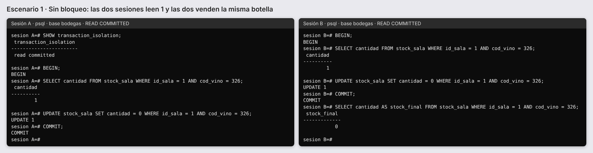

**Escenario 2 · Con `SELECT ... FOR UPDATE`.** La sesión A bloquea la fila. La sesión B queda esperando hasta que A confirma; recién entonces obtiene la fila con el valor nuevo (0) y rechaza la venta.

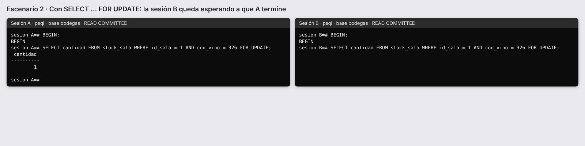

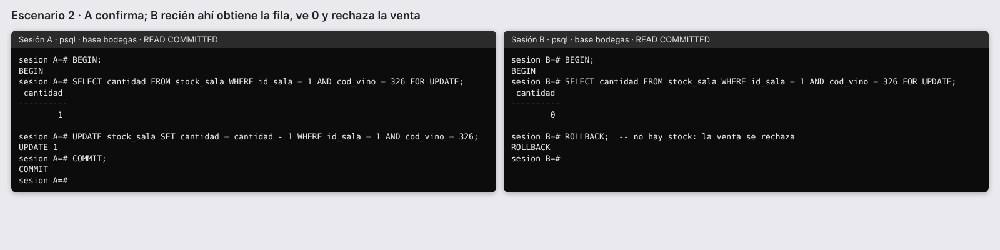

**Escenario 3 · El sistema real.** Las sesiones solo insertan el renglón de venta, como hace la API. El trigger `trg_renglon_comprobante_antes` hace el `FOR UPDATE` sobre `stock_sala` antes de validar: la venta de B espera y, cuando A confirma, falla con RN-09. Además, el `CHECK (cantidad >= 0)` es una segunda barrera.

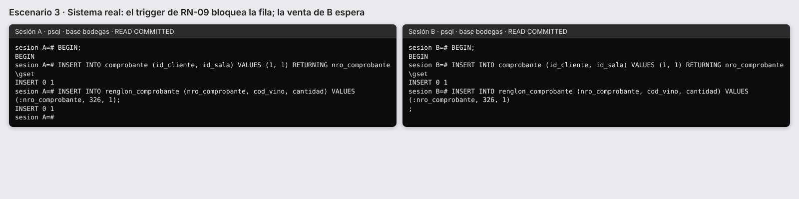

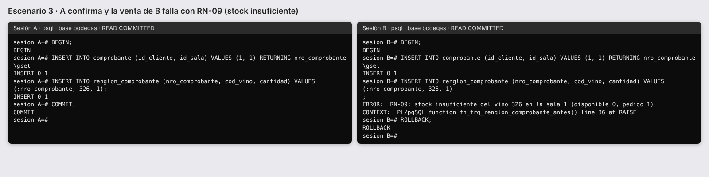

# 4. Carga masiva

**Catálogos reales** desde CSV (`db/seed/catalogos`): 18 departamentos de Mendoza, 35 localidades con su código postal (incluye CP compartidos), las 12 cepas y los 8 maridajes del enunciado. Bodegas, fincas, clientes y transportistas se generan con Faker (`es_AR`) y son ficticios.

**Orden de carga.** Primero las tablas sin dependencias (provincia, cepa, maridaje, bodega, transportista); después departamento, localidad, salas y empleados; fincas, parcelas, lotes y análisis; vinos, composición y maridajes; clientes y subtipos; ingresos, transferencias y stock; por último comprobantes y renglones.

**Datos coherentes.** El script simula día por día los últimos seis años: llegan ingresos al depósito, cada sala se repone con transferencias cada unos 15 días y las ventas solo usan vino con stock en esa sala en ese momento. Los importes se calculan con la misma fórmula que la base.

**Reproducibilidad.** Semilla fija en `random` y en Faker (`SEMILLA=2026`) más una fecha de referencia. Dos cargas con la misma semilla y fecha dieron un hash MD5 idéntico del contenido.

**Estrategia frente a los triggers.** Durante la carga histórica se deshabilitan los triggers de usuario (`ALTER TABLE ... DISABLE TRIGGER USER`) dentro de **una sola transacción**. Si se dejaran activos, rechazarían datos históricos válidos (fechas viejas de transferencia, documentos ya procesados) y recalcularían 150.000 cabeceras fila por fila. Riesgos y mitigación: las claves foráneas y los CHECK siguen activos; si la carga falla, se revierten los datos **y** el deshabilitado; al final, 13 consultas de control verifican lo que vigilaban los triggers.

| Tabla | Filas |
| --- | ---: |
| renglon_comprobante | 523.138 |
| comprobante | 149.972 |
| renglon_transferencia | 23.586 |
| cliente | 20.000 |
| renglon_ingreso | 7.585 |
| transferencia | 5.779 |
| analisis_calidad | 4.858 |
| permiso_exportacion | 4.280 |
| distribuidor | 3.306 |
| stock_sala | 3.318 |
| lote_uva | 2.850 |
| ingreso | 1.782 |
| vino / stock_deposito | 600 |

**Tiempos.** Generación en Python: 6,0 s. Carga completa con `COPY` en una transacción: 8,5 s (de los cuales 5,7 s son los 523.138 renglones). Refresco de la vista materializada y `ANALYZE`: 0,4 s.

**Fila por fila frente a lotes** (5.000 renglones):

| Método | Segundos | Filas por segundo | Veces más rápido |
| --- | ---: | ---: | ---: |
| INSERT fila por fila, un COMMIT por fila | 2,578 | 1.939 | 1,0 |
| executemany en una transacción | 0,141 | 35.534 | 18,3 |
| COPY | 0,026 | 194.638 | 100,4 |

**Consultas de control** (todas dieron 0): renglones sin cabecera, comprobantes sin renglones, totales distintos de la suma de renglones, subtotales mal calculados, descuentos distintos del tipo de cliente, stock negativo, stock de sala distinto de transferido menos vendido, stock de depósito distinto de ingresado menos transferido, composición distinta de 100, ventas anteriores al alta del cliente, ventas anteriores al primer ingreso del vino, cosechas fuera de su campaña y subtipos incoherentes.

# 5. Índices y rendimiento

Se midió cada consulta con `EXPLAIN (ANALYZE, BUFFERS)` solo con los índices de PK y UNIQUE, se crearon los cinco índices de `008_indices.sql`, se corrió `ANALYZE` y se volvió a medir (mediana de tres ejecuciones, con paralelismo y JIT desactivados).

| Consulta | Antes (ms) | Después (ms) | Mejora | Recorrido después |
| --- | ---: | ---: | ---: | --- |
| S2 · Vinos vendidos en todas las salas | 27.605,5 | 2.313,3 | 11,9x | Bitmap Index Scan sobre `idx_renglon_comprobante_vino` |
| S3 · Ventas de una sala en 90 días | 7,3 | 0,1 | 53,6x | Index Only Scan sobre `idx_comprobante_sala_fecha` |
| S8 · Monto por sala en el trimestre | 11,8 | 3,8 | 3,1x | Bitmap Index Scan sobre el BRIN de fecha |
| S12a · Clientes que compraron todos los vinos de una bodega | 125.672,6 | 589,2 | 213,3x | Bitmap Heap Scan sobre comprobante por cliente |
| S5 · Salas con menos transferencias pendientes | 0,3 | 0,1 | 2,6x | índice parcial de pendientes |
| D4 · Borrar socios sin compras (chequeo de FK) | 4.315,4 | 17,4 | 247,7x | Index Scan sobre `idx_comprobante_cliente` |

| Índice | Tipo | Tamaño | Justificación |
| --- | --- | ---: | --- |
| `renglon_comprobante (cod_vino)` | sobre clave foránea | 3,6 MB | La PK (comprobante, vino) no sirve para buscar por vino. |
| `comprobante (id_cliente)` | sobre clave foránea | 1,4 MB | PostgreSQL no indexa las FK: borrar un cliente recorría todos los comprobantes. |
| `comprobante (id_sala, fecha) INCLUDE (total, id_cliente)` | compuesto + INCLUDE | 6,0 MB | Igualdad primero, rango después; resuelve sin leer la tabla. |
| `transferencia (...) WHERE estado <> 'procesado'` | parcial | 16 kB | Solo indexa las ~150 pendientes. |
| `comprobante USING brin (fecha)` | BRIN | 24 kB | Las ventas se insertan en orden de fecha; un B-tree equivalente ocupa 1 MB. |

**Índice descartado.** Para S3 se probó `(fecha, id_sala)`. Con la fecha primero, el índice recorre los 90 días de todas las salas y descarta las que no son la 1: leyó 35 páginas contra 6 del índice elegido.

**Cuándo el planificador no usa un índice.** (1) Con un índice sobre `vino(tipo)`, el filtro `tipo = 'tinto'` devuelve el 61 % de las filas y el planificador prefiere recorrer la tabla. (2) `EXTRACT(YEAR FROM fecha) = 2025` no puede usar el índice sobre `fecha`; reescrita como rango sí lo usa. (3) Sin `ANALYZE` después de la carga, las estimaciones son malas.

**Costo de escritura.** Insertar todas las filas en una copia con solo la PK y con los índices: `renglon_comprobante` pasó de 0,79 s a 1,06 s (+33 %) y `comprobante` de 0,47 s a 0,82 s (+76 %). Cada índice se actualiza en cada escritura; por eso solo se crearon los que tienen una consulta que los justifica.

Los planes completos están en `docs/informes/etapa4_planes.md` y `docs/informes/etapa5_explain_avanzadas.md`.

# 6. Consultas SQL

Las consultas de la sección 8 del enunciado están en `consultas/update.sql`, `insert.sql`, `delete.sql` y `select.sql`. Cada una tiene su código, la estrategia comentada y, si modifica datos, se prueba con `BEGIN` → control previo → sentencia → control posterior → `ROLLBACK`. Los parámetros (bodega, sala, localidad, vino) están al comienzo de cada archivo.

Comentarios sobre las más interesantes:

- **U1** No se puede actualizar el total a mano (RN-08). Se corrige el porcentaje de los renglones que no coinciden con el tipo de cliente y los triggers recalculan subtotales y cabeceras.
- **U4** El intercambio lunes ↔ miércoles se hace en una sola sentencia con `CASE`; no hay "ida y vuelta" porque un UPDATE evalúa todas las filas sobre la versión anterior.
- **U5 e I1** `LEFT JOIN` para incluir a quien tiene cero (vinos nunca vendidos, transportistas sin envíos), con la condición de fecha en el `ON` y no en el `WHERE`.
- **I2** Un CTE que inserta el maridaje y devuelve su id (`RETURNING`) alimenta la segunda inserción en una sola sentencia.
- **I3** La venta en una transacción, igual que la API: la cabecera nace en cero y los triggers completan todo.
- **D1 y D5** Los renglones se borran en cascada. En D5, el trigger de RN-12 permite el borrado en cascada (la cabecera ya no existe) pero no el borrado suelto de un renglón.
- **S2 y S12a** División relacional con doble `NOT EXISTS`: "no existe una sala (o un vino de la bodega) para el que no exista una venta". S2 se verificó también con una versión por conteo.
- **S9** La vista `v_ficha_vino` agrega cepas y maridajes en subconsultas separadas para evitar el producto cartesiano.
- **S10** Expresión de tabla común con el rendimiento por hectárea y subconsulta correlacionada con el promedio de la finca en la campaña.
- **S11** `RANK() OVER (PARTITION BY sala ORDER BY botellas DESC)` y acumulado con `SUM() OVER (PARTITION BY sala ORDER BY mes)`.

Triggers y restricciones que se activaron: U1 (recalcula importes), U3 y U5 (auditoría de precios), I3 (stock e importes), D1 y D5 (cascadas), D4 (la clave foránea de comprobante hacía lento el borrado hasta crear su índice).

# 7. API y front

## 7.1 Arquitectura

El navegador consume la API con JSON. La API (Express) tiene rutas que solo manejan HTTP, una capa de acceso a datos con una función por consulta (`api/src/dao`) y un pool de conexiones configurado por variables de entorno. Todo el SQL es parametrizado (`$1`, `$2`). Las operaciones de varias sentencias usan transacciones explícitas (`BEGIN` / `COMMIT` / `ROLLBACK`). La API se conecta con `bodegas_api`; `/salud` lo muestra. No calcula totales, descuentos ni stock: la venta envía solo cliente, sala, vinos y cantidades, y procesar un documento ejecuta `CALL sp_procesar_...`.

## 7.2 Endpoints

| Recurso | Rutas |
| --- | --- |
| Vinos | `GET /vinos` (filtros y paginación), `GET/POST/PUT/DELETE /vinos/{cod}`, `GET /vinos/{cod}/precios` |
| Clientes | `GET/POST /clientes`, `GET/PUT/DELETE /clientes/{id}` (los tres tipos) |
| Comprobantes | `POST /comprobantes`, `GET /comprobantes/{nro}` |
| Transferencias e ingresos | alta, renglones, `terminar` y `procesar` |
| Reportes | `top-vinos`, `ventas-por-sala`, `vinos-sin-stock`, `transportista-activo`, `trazabilidad/{cod}` |

La documentación OpenAPI está en `/docs`.

## 7.3 Traducción de errores

| Situación | SQLSTATE | HTTP |
| --- | --- | --- |
| UNIQUE | 23505 | 409 |
| FK: dato inexistente / borrar con dependientes | 23503 | 422 / 409 |
| CHECK, NOT NULL | 23514, 23502 | 422 |
| Regla de negocio de un trigger o procedimiento | P0001 | 409 (con la regla, por ejemplo RN-09) |
| Formato inválido | 22P02 | 400 |
| Serialización o deadlock | 40001, 40P01 | 503 |

## 7.4 Pruebas

22 pruebas automáticas, todas pasan. Once provocan a propósito una violación de una regla de la base (corte de 90 %, precio negativo, vino duplicado, venta sin stock con un renglón válido antes, borrar un vino vendido, transferencia sin stock, ingreso en confección, renglón en documento procesado, permiso con fechas invertidas, descuento fuera de rango, tipo inexistente). En cada caso verifican el código HTTP y que no hayan quedado datos a medias.

## 7.5 Inyección SQL fallida

Se envió `' OR 1=1; DROP TABLE vino; --` al filtro de nombre. Como viaja como parámetro `$1` de `nombre ILIKE '%' || $1 || '%'`, se busca un vino cuyo nombre contenga ese texto literal: la respuesta es una lista vacía y la tabla sigue existiendo.

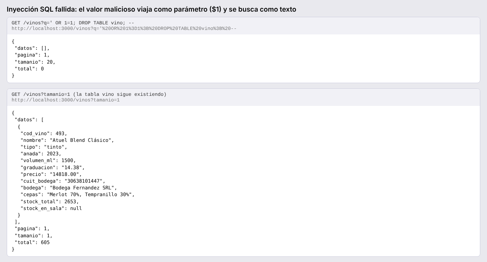

## 7.6 Front

Cinco pantallas: catálogo con filtros y ficha, alta y edición de vino, nueva venta, transferencias y tablero. Todas muestran tal cual los errores que devuelve la base.

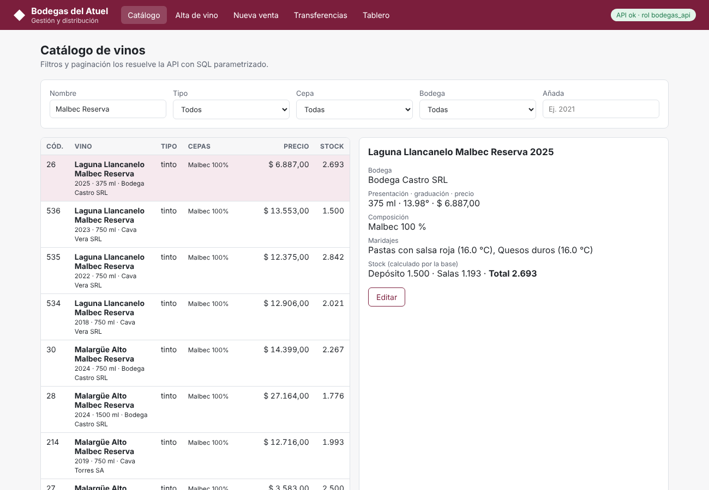

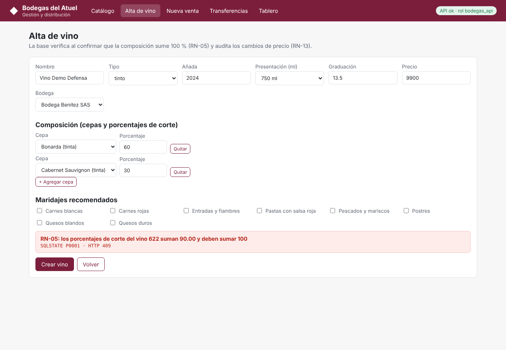

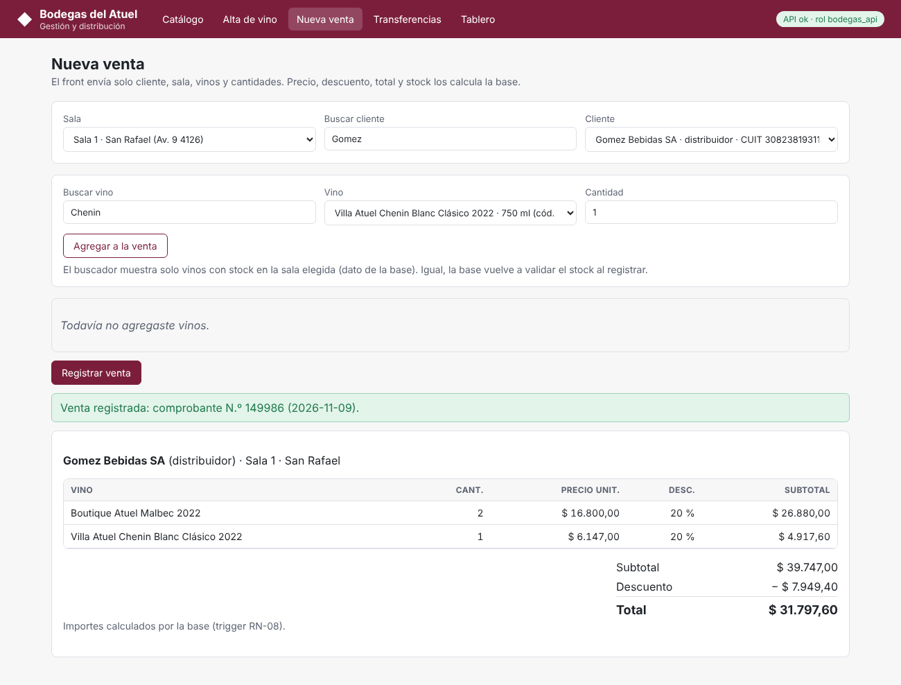

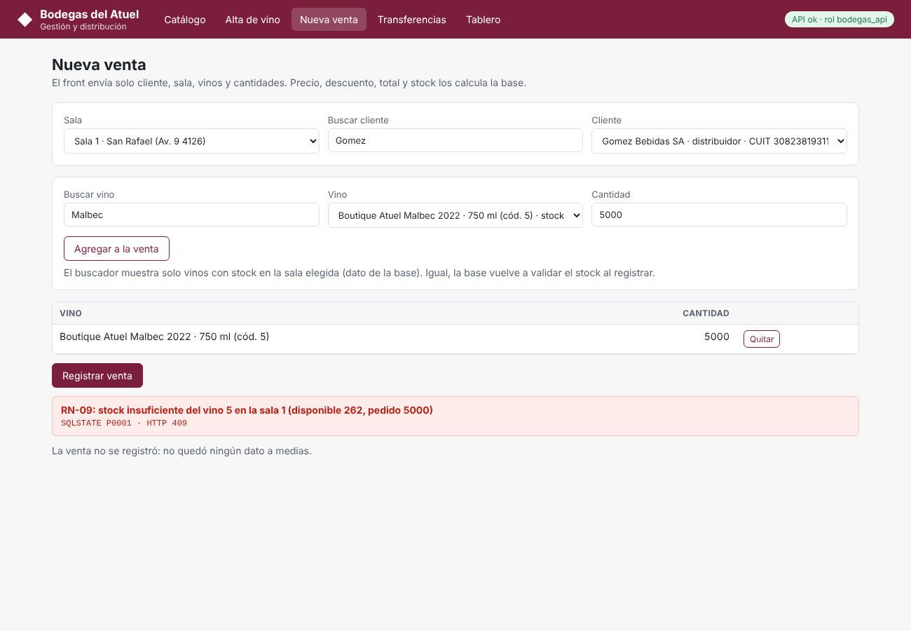

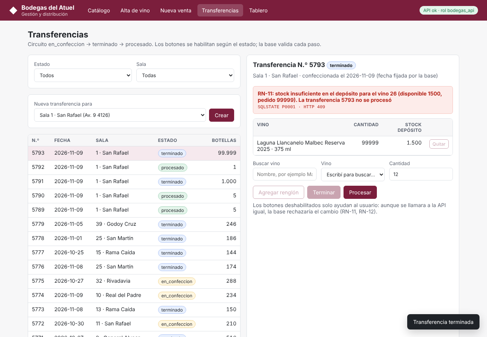

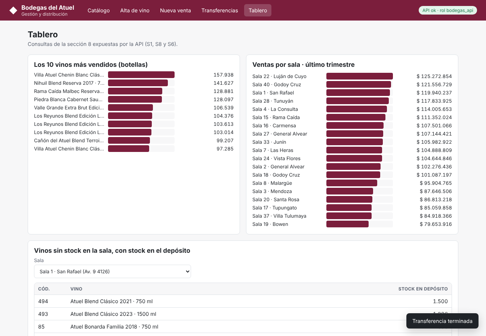

# 8. Despliegue en la nube

| Componente | Servicio en Render | URL |
| --- | --- | --- |
| Front | Static Site `bodegas-front` | https://bodegas-front-pxxx.onrender.com |
| API | Web Service `bodegas-api` (Docker, `api/Dockerfile`) | https://bodegas-api-7s4s.onrender.com (salud: `/salud`, documentación: `/docs`) |
| Base de datos | Render Postgres 16 `bodegas-db`, región Ohio, plan Free | sin URL pública de uso: solo la API, por la red interna, y una IP de administración |

**Proveedor elegido: Render**, para los tres componentes. Se comparó con Neon + Render y con un servidor propio con Docker Compose (tabla completa en `docs/07_despliegue_nube.md`). Se eligió Render porque la API se conecta a la base por la **red interna** del proveedor y el acceso externo a la base se puede cerrar con reglas de IP. Limitaciones del plan gratuito: la base vence a los 30 días de creada (se creó el 10/11/2026) y la API se suspende tras 15 minutos sin tráfico; el primer pedido después tarda alrededor de un minuto. Si la base vence antes de la defensa, la alternativa es Neon, cambiando solo `DATABASE_URL`.

**Cómo se desplegó.**

1. Se creó la base y, desde la máquina de administración, se aplicaron las migraciones 001 a 009 con `db/scripts/aplicar_migraciones.sh` usando el rol administrador del proveedor (que queda como propietario de los objetos).
2. Se asignaron contraseñas generadas al azar a `bodegas_api` y `bodegas_lectura`; no están en el repositorio.
3. Se ejecutó la carga masiva completa contra la base en la nube con el mismo script y la misma semilla: 149.972 comprobantes y 523.561 renglones en 411 s (más lento que en local por la latencia de red). Las 13 consultas de control dieron 0.
4. Se publicó la API con `DATABASE_URL` apuntando a la URL **interna** con el rol `bodegas_api`, y el front con la URL pública de la API en `front/js/config.js`.

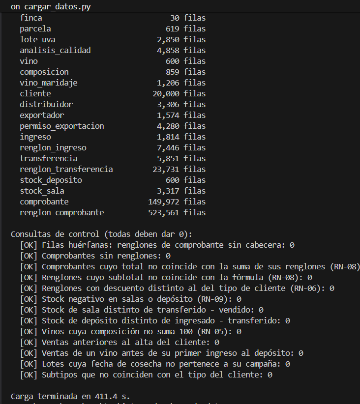

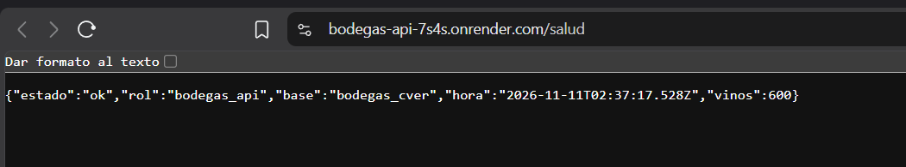

**Regla de negocio en la nube.** Desde el front publicado se intentó vender 9.999 botellas de un vino con 249 en la sala 1. La base rechazó la venta con RN-09 (SQLSTATE P0001, HTTP 409) y no quedó ningún dato a medias.

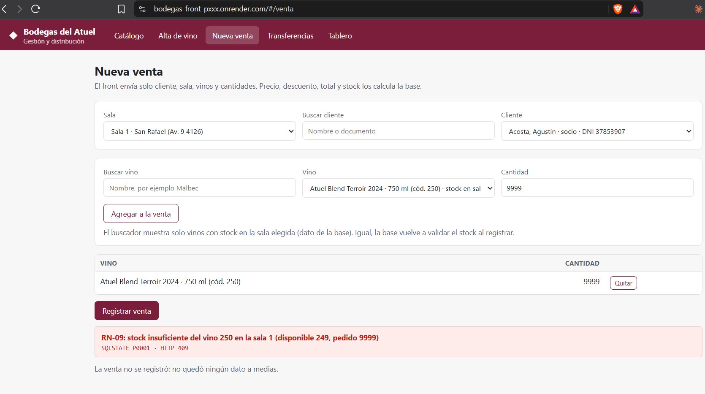

**Seguridad aplicada.**

| Medida | Cómo se cumple | Evidencia |
| --- | --- | --- |
| La API no usa el administrador | `DATABASE_URL` con el rol `bodegas_api` (sin privilegios de propietario) | `/salud` muestra `"rol":"bodegas_api"` |
| Base cerrada a internet | Regla de entrada de la base: solo la IP de administración (`/32`); la API usa la red interna y no se ve afectada | validador de Render y conexión rechazada desde otra red |
| Conexión cifrada | Externa: `sslmode=require` (Render rechaza `sslmode=disable`). Interna: TLS con `DB_SSL=require` | configuración de la API |
| Secretos fuera del repositorio | Contraseñas solo en las variables de entorno de Render; `.env` en `.gitignore` | historial del repositorio |
| CORS | `CORS_ORIGIN` limitado a la URL del front | variables de la API |

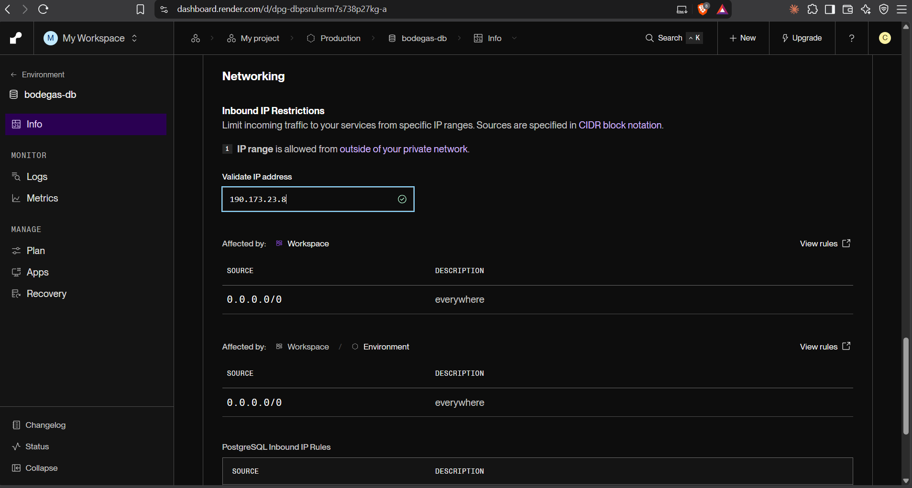

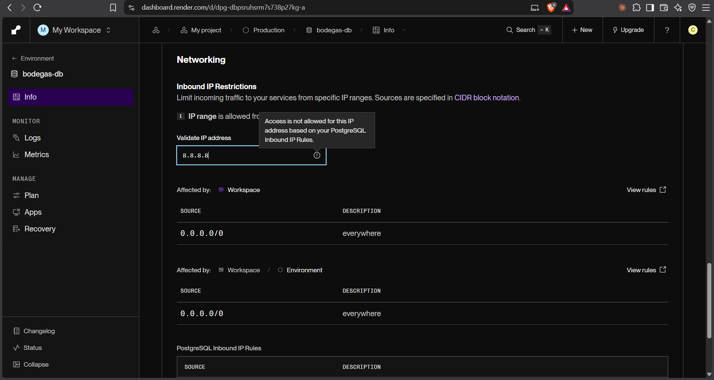

**Prueba de conexión rechazada.** Con el rol de solo lectura, la misma conexión responde desde la IP permitida y es cortada por el proveedor desde otra red:

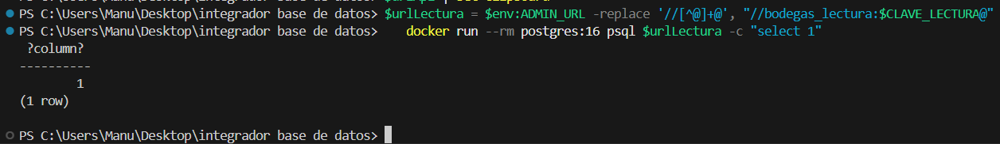

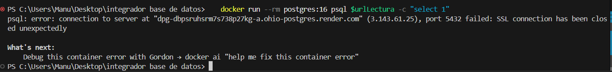

**Backup y restauración.** Se generó un backup completo con `pg_dump --format=custom` (6,6 MB), se restauró en una base nueva con `pg_restore` y se compararon los conteos de las 30 tablas con `db/scripts/conteos.sql`: idénticos. La prueba se hizo con la base local, que tiene el mismo esquema y la misma carga (misma semilla) que la de la nube; los mismos scripts (`db/scripts/backup.sh` y `restaurar.sh`) funcionan contra la base en la nube con su URL externa.

# 9. Conclusiones

**Dificultades.**

- Generar datos históricos coherentes fue lo más trabajoso. Generar cada tabla por separado daba stock negativo y ventas de vinos que todavía no habían llegado a la sala. Se resolvió simulando la historia día por día y verificando con consultas de control.
- Decidir qué hacer con los triggers durante la carga obligó a entender qué garantizaba cada uno, para controlarlo después de otra manera.
- Distinguir una modificación manual de los importes de la que hace el propio trigger requirió usar `pg_trigger_depth()`.

**Decisiones que cambiaría.**

- Obligaría desde la base que cada distribuidor y exportador tenga su fila de subtipo (participación total), con un trigger diferido.
- Generaría también un historial de precios en la carga, para que las ventas viejas tengan precios de su época.
- Desplegaría en la nube antes, para no depender de un plan gratuito al final del cuatrimestre.

**Aprendizajes.**

- Un CHECK no alcanza para reglas que miran otras filas o la fecha actual.
- PostgreSQL no indexa las claves foráneas, y eso se nota sobre todo al borrar.
- El orden de las columnas en un índice compuesto cambia el rendimiento.
- READ COMMITTED no evita vender dos veces la misma botella si se decide con un dato leído antes; `FOR UPDATE` sí.
- Guardar un dato derivado es una decisión válida si se justifica y se protege su consistencia.
